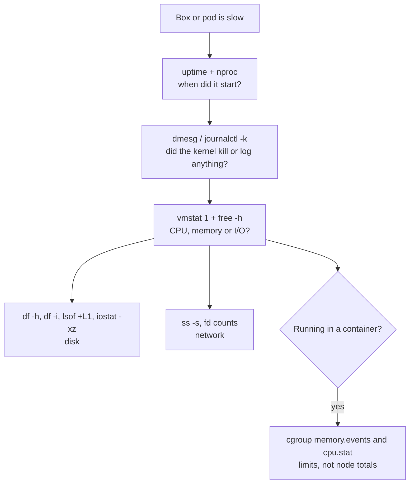

Most production incidents I have worked on started with the same sentence: "the server is slow". No error, no stack trace, just a box that is not behaving.

I started my career as a Linux admin, and for four years I looked after RHEL 6 and 7 servers running a telecom stack: WebLogic, Tomcat, Apache, messaging, all in a private data centre. Today most of what I run lives in Kubernetes on AWS. The platform changed completely. The first five minutes did not.

This post is that five-minute routine. The first half is the classic version for a VM or bare-metal server. The second half is what changes when the "server" is a container, which is where most people get surprised.

## The rule: measure before you restart

Restarting the service fixes a lot of incidents. It also destroys the evidence. Before touching anything, I want to know which resource is in trouble: CPU, memory, disk or network. Everything below answers that question, in that order.

## 1. How long has it been bad?

```bash
uptime
```

```text
 10:42:17 up 41 days,  3:12,  2 users,  load average: 18.40, 12.15, 4.02
```

The three numbers are the 1, 5 and 15 minute load averages. Compare them with each other, not with some magic number. Here the load is climbing fast: this started in the last few minutes, so whatever changed, changed recently.

Then compare with the CPU count:

```bash
nproc
```

A load of 18 on a 32-core box is fine. On a 4-core box it is a queue.

> [!NOTE]
> On Linux, load average counts processes waiting for CPU **and** processes stuck in uninterruptible sleep (state `D`), which usually means waiting on disk or NFS. A high load with idle CPUs points at storage, not compute.

## 2. Did the kernel already tell us?

```bash
dmesg -T | tail -50
# or, on systemd machines
journalctl -k --since "1 hour ago"
```

This is the step people skip, and it is often the whole answer. Look for:

- `Out of memory: Killed process 4211 (java)`: the OOM killer chose a victim.
- `I/O error`, `EXT4-fs error`, `blk_update_request`: a disk or volume is failing.
- `nf_conntrack: table full, dropping packet`: the connection tracking table is full, and new connections are silently dropped.
- `TCP: out of memory -- consider tuning tcp_mem`: the network stack is under pressure.

If the kernel killed your process, no amount of application logs will explain why. The kernel log will.

## 3. The one-screen overview

```bash
vmstat 1 5
```

```text
procs -----------memory---------- ---swap-- -----io---- -system-- ------cpu-----
 r  b   swpd   free   buff  cache   si   so    bi    bo   in   cs us sy id wa st
 9  4 812340  94120   2100 310544  412  980  6120  3400 9120 15200 22 18  8 52  0
```

`vmstat` shows almost everything in one line per second. The columns I read first:

| Column | What it means | Bad sign |
|---|---|---|
| `r` | Processes waiting for CPU | Consistently above the CPU count |
| `b` | Processes blocked, usually on I/O | Anything above 0 for several seconds |
| `si` / `so` | Memory swapped in / out per second | Non-zero and steady: the box is short of RAM |
| `wa` | CPU time waiting for I/O | High while `us` is low: storage is the bottleneck |
| `st` | Time stolen by the hypervisor | Non-zero on a VM: a noisy neighbour or burst credits |

The example above is a box swapping heavily (`si`/`so`), with processes blocked on I/O (`b`, `wa`). The swapping is causing the I/O. The real problem is memory.

Confirm with:

```bash
free -h
```

Read the `available` column, not `free`. Linux uses spare RAM as page cache, so `free` is almost always low on a healthy machine. `available` is what applications can actually get.

## 4. Disk: space, inodes and the files that are not there

```bash
df -h
df -i
```

Everybody checks `df -h`. Fewer people check `df -i`. A filesystem can have 40% free space and still refuse to create a file because it ran out of **inodes**, usually from millions of tiny session or cache files. The error is the same "No space left on device", which sends people looking in the wrong place.

The other classic: `df` says the disk is full, but `du` cannot find the space.

```bash
lsof +L1
```

```text
COMMAND  PID  USER  FD  TYPE DEVICE   SIZE/OFF NLINK    NODE NAME
java    4211  app   12w  REG  253,2 8392310784     0  131081 /var/log/app/server.log (deleted)
```

Someone deleted a large log file while the process still had it open. The name is gone, but the space is not freed until the process closes the file. Restarting the process releases it. If you cannot restart, you can truncate the file through `/proc`:

```bash
: > /proc/4211/fd/12
```

> [!WARNING]
> Do not "clean up" with `rm` on a log that a process is writing to. Truncate it (`: > file`) or use logrotate with `copytruncate`. Deleting it just hides the problem until the next `df` alert.

For I/O load, `iostat` from the `sysstat` package shows each device:

```bash
iostat -xz 1
```

Watch `%util` and the wait times (`r_await`, `w_await`). A device near 100% with wait times in the tens of milliseconds is saturated. On AWS, this is often an EBS volume that has used up its burst balance.

## 5. Network: who is connected, and how many

```bash
ss -s
ss -tan state time-wait | wc -l
ss -ltnp
```

`ss -s` gives a summary. A sudden jump in `TIME-WAIT` or `CLOSE-WAIT` connections tells a story:

- Thousands of **TIME-WAIT**: something is opening a new connection for every request instead of reusing them. Common with HTTP clients that have no connection pool.
- Growing **CLOSE-WAIT**: the remote side closed the connection, but your application never did. That is an application bug, usually a missing `close()` on an error path.

And check file descriptors, because every socket is one:

```bash
ls /proc/4211/fd | wc -l
grep 'open files' /proc/4211/limits
```

If the first number is close to the second, the process is about to hit `Too many open files`, and it will start failing in strange ways long before it crashes.

## The same five minutes, inside Kubernetes

Everything above still applies, but three things change.

### There is often no shell

Many production images are distroless or stripped down. There is no `bash`, no `ps`, no `ss`. `kubectl exec` gets you nowhere.

Attach a temporary debug container to the pod instead:

```bash
kubectl debug -it pod/checkout-7d9f8 \
  --image=busybox:1.36 \
  --target=checkout
```

With `--target`, the debug container shares the process namespace of the `checkout` container. You can run `ps`, read `/proc/<pid>/` for the application, and even look at its filesystem through `/proc/<pid>/root/`, all without changing the image.

If you have node access, `nsenter` lets you use the node's own tools inside the pod's network namespace:

```bash
# on the node: find the container's PID
PID=$(crictl inspect <container-id> | jq .info.pid)

# run the node's ss inside the pod's network namespace
nsenter -t "$PID" -n ss -tanp
```

### "Free memory" is the wrong number

This is the one that catches experienced Linux people. A pod gets `OOMKilled`, you log in to the node, run `free -h`, and the node has gigabytes available.

Both are true. The container was not killed because the **node** ran out of memory. It was killed because it hit **its own** limit, enforced by its cgroup.

```bash
kubectl get pod checkout-7d9f8 \
  -o jsonpath='{.status.containerStatuses[*].lastState.terminated.reason}'
# OOMKilled
```

Inside the container (cgroup v2), the real numbers are here:

```bash
cat /sys/fs/cgroup/memory.max      # the limit
cat /sys/fs/cgroup/memory.current  # current usage, including page cache
grep oom /sys/fs/cgroup/memory.events
```

`memory.events` counts how many times the OOM killer has fired inside this cgroup. If `oom_kill` is not zero, the limit is too small for what the application actually does, or the application has a leak. `free` inside a container usually shows the **node's** memory, so do not trust it there.

> [!TIP]
> For JVM services, also check that the heap is sized from the container limit (`-XX:MaxRAMPercentage`) and not hard-coded. A 4 GB heap in a container with a 4 GB limit leaves no room for metaspace, threads and buffers, and the kernel will kill it.

### The CPU is idle, but the app is slow

The CPU version of the same surprise. Node CPU is at 30%, yet the service is slow and latency spikes every few seconds.

If the container has a CPU **limit**, the kernel lets it use only so much CPU time per 100 ms period. Use it up early, and the process waits for the next period, even if the node has idle cores.

```bash
cat /sys/fs/cgroup/cpu.stat
```

```text
usage_usec 912384021
nr_periods 184022
nr_throttled 61230
throttled_usec 4120338811
```

Here a third of all periods were throttled. That is the latency spike. The fix is to raise the limit, remove it for latency-sensitive services, or make the application do less work per request. Adding more replicas only spreads the throttling around.

## The routine, on one screen



| Step | Command | Question it answers |
|---|---|---|
| 1 | `uptime`, `nproc` | Is it getting worse, and is the load real? |
| 2 | `dmesg -T`, `journalctl -k` | Did the kernel already explain it? |
| 3 | `vmstat 1`, `free -h` | Which resource: CPU, memory or I/O? |
| 4 | `df -h`, `df -i`, `lsof +L1`, `iostat -xz 1` | Is it the disk? |
| 5 | `ss -s`, `/proc/<pid>/fd` | Is it the network or file descriptors? |
| K8s | `kubectl debug`, `nsenter` | How do I look inside with no shell? |
| K8s | `memory.events`, `cpu.stat` | Is it the container limit rather than the node? |

## What 13 years taught me about this list

None of these commands are new. Most of them existed when I was racking RHEL servers, and they still work on the nodes underneath every managed Kubernetes cluster. The tooling on top keeps changing: dashboards, APM, now AI assistants that summarise alerts. They are useful, and I use them. But when the dashboard is wrong or missing, which during a real incident is more often than we admit, these five minutes on the box itself are still the fastest way to the truth.

If you have a command that belongs on this list, tell me in the comments.
