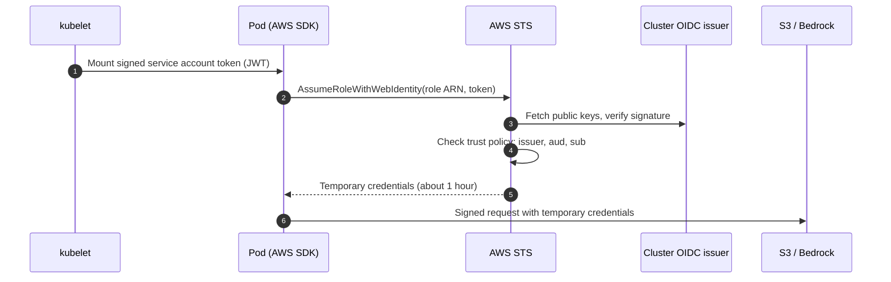

A pod needs to read from S3, write to DynamoDB or call Bedrock. The quick answer is an access key in a Kubernetes Secret. It works on day one. Then the key ends up in a repo, a log line or a laptop, and nobody remembers which twenty services use it when it has to be rotated.

On EKS you do not need that key at all. Most of the AI applications I onboarded onto Bedrock, and most of the services reaching S3 and databases from our namespaces, run with **zero static credentials**. Each pod gets short-lived credentials for its own IAM role, and they rotate on their own.

The feature is called **IRSA**, IAM Roles for Service Accounts. Many teams use it by copying an annotation from another namespace. That works until it does not, and then nobody knows where to look. So this post goes through what actually happens, step by step, and how to debug each step.

## Three ways a pod can get AWS credentials

| Option | How it works | Problem |
|---|---|---|
| Static access key | Key and secret stored in a Secret or env var | Long-lived, leaks, painful rotation |
| Node role through IMDS | Pod calls the EC2 metadata endpoint and gets the **node's** role | Every pod on the node shares the same permissions |
| IRSA or EKS Pod Identity | Each service account maps to its own IAM role | None of the above, once it is set up correctly |

The second row deserves a warning. If a pod can reach `169.254.169.254`, it can often get the node's IAM role, which usually has permissions to pull images and describe EC2 resources. Any pod on that node, including one with a remote code execution bug, gets the same access. We will come back to this, because it is also the silent fallback when IRSA is broken.

## What happens when the pod calls AWS

Here is the full flow for IRSA:



There are four moving parts. When IRSA fails, exactly one of them is wrong.

### 1. The cluster is an identity provider

Every EKS cluster has an **OIDC issuer URL**. The cluster signs service account tokens with its private key and publishes the public keys at that URL. For AWS to trust those tokens, you create an **IAM OIDC provider** in your account that points at the issuer.

```bash
aws eks describe-cluster --name my-cluster \
  --query "cluster.identity.oidc.issuer" --output text
# https://oidc.eks.ap-south-1.amazonaws.com/id/EXAMPLED539D4633E53DE1B71EXAMPLE

aws iam list-open-id-connect-providers | grep EXAMPLED539D4633E53DE1B71EXAMPLE
```

If the second command returns nothing, no role in this account can be assumed from this cluster.

### 2. The service account says which role it wants

```yaml
apiVersion: v1
kind: ServiceAccount
metadata:
  name: checkout
  namespace: payments
  annotations:
    eks.amazonaws.com/role-arn: arn:aws:iam::111122223333:role/payments-checkout
```

The annotation by itself does nothing. EKS runs a mutating webhook (the Pod Identity Webhook). When a pod is **created** with this service account, the webhook adds:

- a projected volume with a token whose audience is `sts.amazonaws.com`, mounted at `/var/run/secrets/eks.amazonaws.com/serviceaccount/token`
- `AWS_ROLE_ARN`, taken from the annotation
- `AWS_WEB_IDENTITY_TOKEN_FILE`, pointing at that token

> [!IMPORTANT]
> The webhook only acts when a pod is created. If you add or change the annotation on a running workload, existing pods keep their old environment. Restart them: `kubectl rollout restart deploy/checkout -n payments`.

### 3. The token says who the pod is

The token is a normal JWT. You can read it from inside the pod:

```bash
kubectl exec -n payments deploy/checkout -- \
  cat /var/run/secrets/eks.amazonaws.com/serviceaccount/token \
  | jq -R 'split(".")[1] | gsub("-";"+") | gsub("_";"/") | @base64d | fromjson'
```

```json
{
  "aud": ["sts.amazonaws.com"],
  "iss": "https://oidc.eks.ap-south-1.amazonaws.com/id/EXAMPLED539D4633E53DE1B71EXAMPLE",
  "sub": "system:serviceaccount:payments:checkout",
  "exp": 1761370800
}
```

The `sub` field is the important one: `system:serviceaccount:<namespace>:<name>`. That string is what the IAM role will check.

### 4. The role decides who may assume it

The role's **trust policy** is where most IRSA problems live:

```json
{
  "Version": "2012-10-17",
  "Statement": [
    {
      "Effect": "Allow",
      "Principal": {
        "Federated": "arn:aws:iam::111122223333:oidc-provider/oidc.eks.ap-south-1.amazonaws.com/id/EXAMPLED539D4633E53DE1B71EXAMPLE"
      },
      "Action": "sts:AssumeRoleWithWebIdentity",
      "Condition": {
        "StringEquals": {
          "oidc.eks.ap-south-1.amazonaws.com/id/EXAMPLED539D4633E53DE1B71EXAMPLE:aud": "sts.amazonaws.com",
          "oidc.eks.ap-south-1.amazonaws.com/id/EXAMPLED539D4633E53DE1B71EXAMPLE:sub": "system:serviceaccount:payments:checkout"
        }
      }
    }
  ]
}
```

STS assumes the role only if the token was signed by that cluster **and** the `aud` and `sub` match exactly. One namespace typo, and you get an error that says nothing about namespaces.

> [!WARNING]
> Do not "fix" a mismatch with `StringLike` and `system:serviceaccount:*`. That lets every service account in every namespace of the cluster assume the role. Use the exact name.

The role's **permission policy** is separate. It decides what the pod can do once it has the role: which buckets, which Bedrock models, which tables.

## Debugging it in two minutes

Start with one command inside the pod. It answers "who am I to AWS?":

```bash
kubectl exec -n payments deploy/checkout -- aws sts get-caller-identity
```

(If the image has no AWS CLI, use a `kubectl debug` container with the same service account, or a one-off pod.)

| What you see | What it means | Where to look |
|---|---|---|
| `assumed-role/payments-checkout/...` | IRSA works | If calls still fail, check the permission policy, bucket policy or KMS key policy |
| `assumed-role/eks-node-role/i-0abc...` | The pod is using the **node** role | Env vars missing: pod created before the annotation, wrong service account name, or app code forcing the instance profile |
| `Not authorized to perform sts:AssumeRoleWithWebIdentity` | Trust policy rejected the token | `sub` (namespace or name) or `aud` mismatch, or wrong OIDC provider ID in the principal |
| `InvalidIdentityToken: No OpenIDConnect provider found` | The account does not trust this cluster | Create the IAM OIDC provider (step 1) |
| `Unable to locate credentials` | No env vars and no IMDS access | Webhook did not mutate the pod; check `kubectl get pod -o yaml` for `AWS_ROLE_ARN` |

And check the environment the webhook should have injected:

```bash
kubectl get pod -n payments -l app=checkout -o yaml \
  | grep -A1 -E 'AWS_ROLE_ARN|AWS_WEB_IDENTITY_TOKEN_FILE'
```

One more cause shows up with older applications: an **old AWS SDK** that does not know the web identity provider. It skips IRSA and moves on to the next provider in its chain, which is usually the node role. The application works, so nobody notices it is running with the wrong permissions.

## Close the fallback: block pods from the node role

That silent fallback is the reason to block pod access to the node's metadata endpoint. If IRSA is misconfigured, you want a loud `Unable to locate credentials`, not a quiet success with the node's permissions.

On EC2, IMDSv2 requests carry a hop limit. A pod's request crosses one extra network hop, so a **hop limit of 1** keeps pods out while the node itself still works. For AL2023 managed node groups, AWS documents that the default is 1 when you do not use a launch template, and 2 when you use a launch template with a custom AMI. Check what yours actually have:

```bash
aws ec2 describe-instances \
  --filters "Name=tag:eks:cluster-name,Values=my-cluster" \
  --query "Reservations[].Instances[].[InstanceId,
           MetadataOptions.HttpTokens,
           MetadataOptions.HttpPutResponseHopLimit]" \
  --output table
```

You want `required` and `1`, unless something on the node genuinely needs IMDS from a pod. In that case, protect it with a NetworkPolicy that blocks `169.254.169.254/32` for everything else.

## EKS Pod Identity: the newer way

AWS later added **EKS Pod Identity**, which solves the same problem with less wiring. Instead of an OIDC provider and a trust policy per cluster, you create an **association** in the EKS API between a service account and a role, and an agent on each node hands out credentials.

```bash
aws eks create-pod-identity-association \
  --cluster-name my-cluster \
  --namespace payments \
  --service-account checkout \
  --role-arn arn:aws:iam::111122223333:role/payments-checkout
```

The role's trust policy no longer mentions any cluster:

```json
{
  "Effect": "Allow",
  "Principal": { "Service": "pods.eks.amazonaws.com" },
  "Action": ["sts:AssumeRole", "sts:TagSession"]
}
```

| | IRSA | EKS Pod Identity |
|---|---|---|
| Setup per cluster | IAM OIDC provider | `eks-pod-identity-agent` add-on |
| Where the mapping lives | Annotation + trust policy | EKS API association |
| Reuse a role across clusters | Edit the trust policy for each cluster | Just add another association |
| Session tags for ABAC | No | Yes (cluster, namespace, service account) |
| Fargate | Yes | No |
| Minimum SDK | Older SDKs work | Needs SDKs from late 2023 or newer |

My rule of thumb: **new EKS clusters on EC2 nodes, use Pod Identity**. Keep IRSA where you run Fargate, where old SDKs cannot be upgraded yet, or where you have many working roles and no reason to touch them. Both can run in the same cluster, so you can move one service at a time.

## Checklist

- [ ] One IAM role per workload, not one per namespace "to keep it simple".
- [ ] Trust policy uses `StringEquals` on both `aud` and `sub`.
- [ ] Pods restarted after any annotation change.
- [ ] `aws sts get-caller-identity` from the pod shows the workload role, not the node role.
- [ ] Nodes use IMDSv2 with a hop limit of 1.
- [ ] No `AWS_ACCESS_KEY_ID` left in any Secret. `kubectl get secrets -A -o json | grep -c AWS_ACCESS_KEY_ID` is a good start.

The best part of getting this right is what disappears: no key rotation tickets, no "who has access to this key" questions in audits, and no credentials to leak. The pod is the identity.
