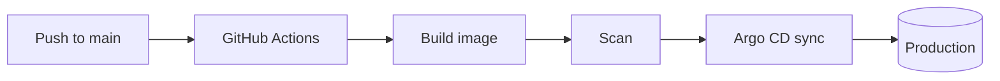
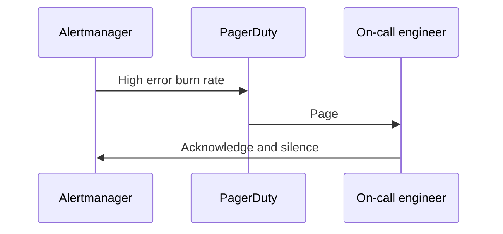

This post is a cheat sheet for writing here. It is marked `draft: true`, so it only shows up when you run `hugo server -D` locally. Copy whatever you need from it.

## Text

Regular paragraphs, **bold**, *italic*, `inline code`, and [links](https://kubernetes.io/docs/). Links to other posts can use their file path, for example [the first post](/posts/starting-this-blog), and the build checks they resolve.

### Lists

- Unordered lists
- With a second item
  - And nesting

1. Ordered lists
2. For steps people follow in order

## Code

Fenced code blocks get syntax colours that follow the light/dark switch, a language label, and a copy button.

```bash
kubectl -n payments rollout status deploy/checkout --timeout=120s
kubectl -n payments get pods -l app=checkout -o wide
```

```yaml
apiVersion: policy/v1
kind: PodDisruptionBudget
metadata:
  name: checkout
spec:
  minAvailable: 2
  selector:
    matchLabels:
      app: checkout
```

```hcl
resource "aws_s3_bucket" "logs" {
  bucket = "example-platform-logs"
}
```

Highlight specific lines with `{hl_lines=[2]}` after the language:

```go {hl_lines=[3]}
func healthz(w http.ResponseWriter, r *http.Request) {
	w.Header().Set("Content-Type", "text/plain")
	w.WriteHeader(http.StatusOK)
	fmt.Fprintln(w, "ok")
}
```

## Callouts

GitHub-style alerts render as coloured boxes:

> [!NOTE]
> Background the reader should know before continuing.

> [!TIP]
> A shortcut or better way to do something.

> [!IMPORTANT]
> Something the reader must not miss.

> [!WARNING]
> Something that can break production if done wrong.

> [!CAUTION]
> Something destructive or irreversible.

A normal quote still looks like a quote:

> Hope is not a strategy.

## Tables

| Signal     | What it tells you              | Alert on it?         |
|------------|--------------------------------|----------------------|
| Latency    | How slow requests are          | Yes, p99 against SLO |
| Traffic    | How much demand there is       | Usually no           |
| Errors     | How many requests fail         | Yes, burn rate       |
| Saturation | How full the system is         | Yes, before it's 100% |

## Diagrams

Mermaid blocks are drawn in the browser and follow the theme:





## Images

Put the image next to this `index.md` and reference it by file name. A title in quotes becomes the caption:

```markdown

```

## Front matter fields

| Field         | Purpose                                                           |
|---------------|-------------------------------------------------------------------|
| `title`       | Post title                                                        |
| `date`        | Publish date; the year groups posts on the home page              |
| `draft`       | `true` keeps it off the live site                                 |
| `description` | Shown on the list, in search results and in link previews         |
| `tags`        | Topics; each tag gets its own page                                |
| `images`      | Optional preview image for LinkedIn and X                         |
| `toc`         | Set `false` to hide the contents box on a long post               |

## Contents box

The contents box appears automatically on posts longer than about 600 words that have headings. This guide is shorter than that, so it has none. Add `toc: false` to the front matter to hide it on a long post.
