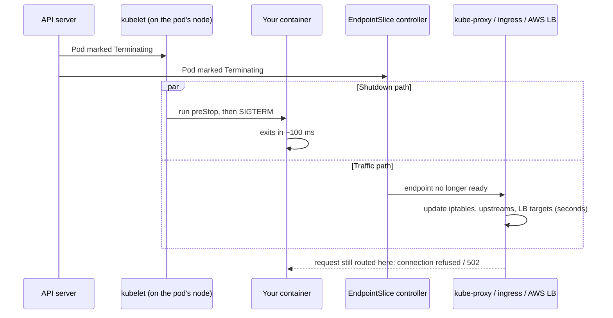

A team ships a small change. The rollout is green, every pod passes its probes, and the dashboard still shows a burst of 502 and 503 errors for about ten seconds. Every deploy, like clockwork.

When you run CI/CD into fifty-plus namespaces, as I did with our shared Jenkins library and later GitHub Actions, you see this pattern a lot. The usual reaction is to blame the ingress or the load balancer. The real cause is almost always the same: **a pod is told to stop before the rest of the system has stopped sending it traffic**.

This post explains why that happens and the four settings that fix it.

## The race nobody draws on the whiteboard

Most people picture pod shutdown like this:

1. Kubernetes removes the pod from the Service.
2. Then it tells the pod to stop.

That is not what happens. When a pod is deleted, two things start **at the same time**:



The shutdown path is local and fast: the kubelet on the same node sends SIGTERM almost immediately, and many applications exit within milliseconds.

The traffic path is distributed and slow. The EndpointSlice has to change, then **every** node's kube-proxy has to rewrite its rules, your ingress controller (NGINX, Kong, whatever you run) has to refresh its upstreams, and if you use the AWS Load Balancer Controller with IP targets, the target has to be deregistered from the ALB. That can take from one second to well over ten.

For that window, traffic keeps arriving at a pod that has already exited. Those are your 502s.

## Fix 1: wait before you stop

The simplest fix is to make the pod keep serving for a few seconds after it is marked terminating, so the traffic path can catch up. That is what a `preStop` hook is for: the kubelet runs it **before** sending SIGTERM.

The old way needed a shell in the image:

```yaml
lifecycle:
  preStop:
    exec:
      command: ["sh", "-c", "sleep 10"]
```

That fails on distroless images, which have no `sh` and no `sleep`. Kubernetes now has a built-in sleep action that needs nothing inside the container. It was added in 1.29, enabled by default from 1.30, and stable since 1.34:

```yaml
lifecycle:
  preStop:
    sleep:
      seconds: 10
```

During those ten seconds the pod is already out of the endpoints for new traffic, but it is still running and still answering whatever arrives late.

> [!TIP]
> How long to sleep? Long enough for your slowest path to converge. 5 seconds is usually enough for kube-proxy and an in-cluster ingress. With ALB IP targets, measure it: 10 to 15 seconds is common.

## Fix 2: handle SIGTERM properly

After the preStop hook, your process gets SIGTERM. A well-behaved service should:

1. Stop accepting **new** connections.
2. Finish the requests already in flight.
3. Close idle keep-alive connections, so clients reconnect to other pods.
4. Exit.

Most frameworks support this, but it is often switched off. In Spring Boot, for example:

```yaml
server:
  shutdown: graceful
spring:
  lifecycle:
    timeout-per-shutdown-phase: 20s
```

There is a classic trap here: **your app may never receive SIGTERM at all**. If the Dockerfile uses the shell form:

```dockerfile
CMD java -jar app.jar
```

then PID 1 is `/bin/sh`, which does not forward signals to Java. After the grace period, the kubelet sends SIGKILL and every in-flight request dies. Use the exec form, so your process is PID 1:

```dockerfile
CMD ["java", "-jar", "app.jar"]
```

Or, if you must run a wrapper script, end it with `exec java -jar app.jar`, or run a small init such as `tini`.

Check what is actually PID 1 in a running container:

```bash
kubectl exec deploy/checkout -- cat /proc/1/cmdline | tr '\0' ' '; echo
```

## Fix 3: give the shutdown enough time

Everything above has to fit inside `terminationGracePeriodSeconds`, which defaults to **30 seconds**. The preStop hook counts against that time.

```text
terminationGracePeriodSeconds  >=  preStop sleep  +  longest request  +  a margin
```

With a 10-second sleep and requests that can take 15 seconds, the default 30 is tight. Set 45 and stop guessing. If the grace period runs out, the kubelet sends SIGKILL, with no further warning to the app.

> [!NOTE]
> If the preStop hook is still running when the grace period ends, the kubelet gives it a one-time 2-second extension, then kills the container. A sleep longer than the grace period does not buy you extra time.

## Fix 4: the startup side

Rolling deploys can drop requests at the other end too: a new pod gets traffic before it can serve it.

- **Readiness probe** that checks the app can actually serve requests, not just that the port is open. Without one, the pod is "ready" the moment the container starts.
- **Do not use the same endpoint for liveness and readiness.** A slow dependency should take a pod out of rotation, not restart it.
- **`maxUnavailable: 0`** with **`maxSurge: 1`** (or 25%) keeps full capacity during the rollout.

And on EKS with the **AWS Load Balancer Controller** using IP targets, there is one more gap. A pod can be ready in Kubernetes while the ALB still considers its target `initial` and is not yet sending it traffic. Meanwhile, the rollout has already terminated an old pod. Turn on **pod readiness gates**, and the pod is not considered ready until the ALB says the target is healthy:

```bash
kubectl label namespace payments \
  elbv2.k8s.aws/pod-readiness-gate-inject=enabled
```

Only pods created after the label get the gate, so restart the deployment once afterwards.

Also look at the target group's **deregistration delay** (300 seconds by default). Lower it to something close to your grace period, so old targets do not sit in `draining` for five minutes on every deploy.

## Putting it together

```yaml
apiVersion: apps/v1
kind: Deployment
metadata:
  name: checkout
spec:
  replicas: 4
  strategy:
    type: RollingUpdate
    rollingUpdate:
      maxUnavailable: 0
      maxSurge: 1
  template:
    spec:
      terminationGracePeriodSeconds: 45
      containers:
        - name: checkout
          image: registry.example.com/payments/checkout:1.42.0
          ports:
            - containerPort: 8080
          readinessProbe:
            httpGet:
              path: /ready
              port: 8080
            periodSeconds: 5
            failureThreshold: 2
          livenessProbe:
            httpGet:
              path: /healthz
              port: 8080
            periodSeconds: 10
            failureThreshold: 3
          lifecycle:
            preStop:
              sleep:
                seconds: 10
```

## Prove it, do not assume it

The nice thing about this problem is that it is easy to measure. Run steady load against the service and roll the deployment while it runs:

```bash
# terminal 1: 60 seconds of steady traffic
hey -z 60s -c 20 https://checkout.example.com/health

# terminal 2: trigger a rollout in the middle
kubectl rollout restart deploy/checkout -n payments
kubectl rollout status  deploy/checkout -n payments
```

`hey` prints a status code summary at the end. Before the fixes, you will see a handful of 502s or connection errors. After, every response should be a 200. Run the same test after every platform change: an ingress upgrade, a new CNI version or a switch to a different load balancer mode can bring the problem back.

## Summary

| Problem | Fix |
|---|---|
| Pod exits before traffic stops arriving | `preStop` with `sleep` (native action on 1.30+) |
| App ignores SIGTERM | Exec-form `CMD`, graceful shutdown in the framework |
| Shutdown killed halfway | `terminationGracePeriodSeconds` above preStop + longest request |
| New pod gets traffic too early | Proper readiness probe, `maxUnavailable: 0` |
| ALB not ready for the new pod | Pod readiness gates, shorter deregistration delay |

None of these settings are exotic, and none of them are on by default. That is why so many clusters drop a few requests on every deploy and call it normal. It is not normal, and it takes about one afternoon to fix.
